# 记录

一天一节，新的一天接在最后。饮食下面分早饭、午饭、晚饭；有加餐时写早加餐、午加餐、晚加餐。照片缩小放在对应那一顿下面。当天合计整行加粗。体重每天 23:30 称。

## 2026-10-14

### 饮食

#### 早饭

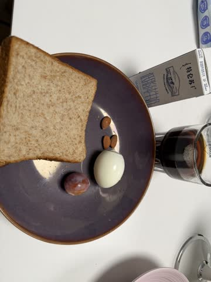

| | 热量 | 蛋白质 | 脂肪 | 碳水 |
|---|---:|---:|---:|---:|
| 全麦吐司 2 片，105 g | 268 | 9 g | 6 g | 40 g |
| 特仑苏低脂 250 ml | 118 | 9 g | 3 g | 13 g |
| 煮蛋 1 个 | 72 | 6 g | 5 g | 0 |
| 坚果 5 个，约 10 g | 55 | 2 g | 4 g | 3 g |
| 西梅 1 个，约 10 g | 4 | 0 | 0 | 1 g |
| 黑咖啡 | 0 | 0 | 0 | 0 |
| **合计** | **517** | **26 g** | **18 g** | **57 g** |

全麦吐司每 100 g：1067 kJ（255 kcal），蛋白质 8.8 g，脂肪 5.8 g，碳水 38.3 g。

#### 午饭

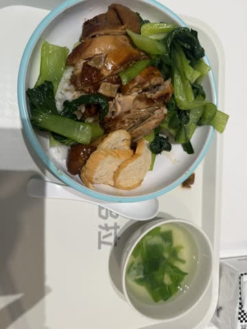
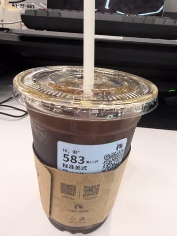

| | 热量 | 蛋白质 | 脂肪 | 碳水 |
|---|---:|---:|---:|---:|
| 熟米饭 约 180 g | 209 | 5 g | 1 g | 47 g |
| 去皮鸡腿 约 140 g | 252 | 36 g | 9 g | 0 |
| 青菜 约 150 g | 45 | 4 g | 0 | 8 g |
| 油豆腐 2 块，约 30 g | 73 | 5 g | 5 g | 1 g |
| 青菜汤 1 碗 | 40 | 2 g | 1 g | 4 g |
| 瑞幸标准美式 1 杯 | 11 | 0 | 0 | 0 |
| **合计** | **630** | **52 g** | **16 g** | **60 g** |

#### 晚饭

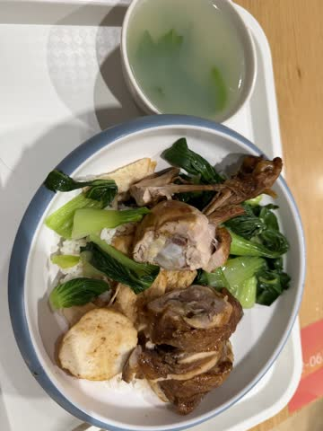

| | 热量 | 蛋白质 | 脂肪 | 碳水 |
|---|---:|---:|---:|---:|
| 熟米饭 约 160 g | 186 | 4 g | 1 g | 42 g |
| 去皮鸡腿 约 130 g | 234 | 34 g | 9 g | 0 |
| 青菜 约 100 g | 30 | 3 g | 0 | 5 g |
| 油豆腐 约 40 g | 98 | 7 g | 7 g | 2 g |
| 青菜汤 1 碗 | 40 | 2 g | 1 g | 4 g |
| **合计** | **588** | **50 g** | **18 g** | **53 g** |

#### 晚加餐

| | 热量 | 蛋白质 | 脂肪 | 碳水 |
|---|---:|---:|---:|---:|
| 香蕉 1 根，约 120 g | 105 | 1 g | 0 | 27 g |
| **合计** | **105** | **1 g** | **0** | **27 g** |

**当天合计：1840 kcal，蛋白质 129 g，脂肪 52 g，碳水 197 g。**

### 训练

练腿。热身，然后三个动作：

1. 单腿硬拉 8×5
2. 腿屈伸一体机，练腘绳肌 5×5
3. 髋内收外展机，练内收肌 20×5

### 体重

23:30，83.9 kg。

## 2026-10-15

### 饮食

#### 早饭

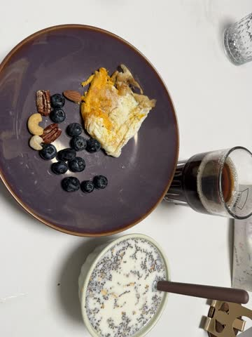

| | 热量 | 蛋白质 | 脂肪 | 碳水 |
|---|---:|---:|---:|---:|
| 高纤快熟燕麦片 100 ml，40 g | 165 | 4.9 g | 5.4 g | 21.9 g |
| 特仑苏低脂 250 ml | 118 | 9 g | 3 g | 13 g |
| 煎蛋 1 个 | 72 | 6 g | 5 g | 0 |
| 煎蛋的油 1 g | 9 | 0 | 1 g | 0 |
| 盐焗混合坚果 10 g | 64 | 1.7 g | 5.5 g | 2.0 g |
| 蓝莓 约 12 颗，约 20 g | 11 | 0 | 0 | 3 g |
| 黑咖啡 1 包，2 g | 7 | 0.4 g | 0 | 1.4 g |
| **合计** | **446** | **22.0 g** | **19.9 g** | **41.3 g** |

燕麦是 100 ml 没压实的一勺，按 40 g 算。营养用《日常》里每 100 g 的包装数。奇亚籽、亚麻籽已经含在这 40 g 里。坚果、黑咖啡、煎蛋的油用《日常》。油按每天早上 1 g。

#### 午饭

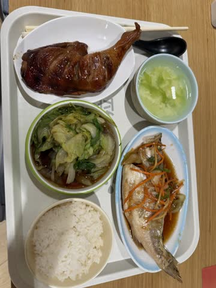

| | 热量 | 蛋白质 | 脂肪 | 碳水 |
|---|---:|---:|---:|---:|
| 熟米饭 约 200 g | 232 | 6 g | 1 g | 52 g |
| 去皮鸡腿 约 150 g | 270 | 39 g | 10 g | 0 |
| 清蒸鱼 约 150 g | 160 | 28 g | 5 g | 0 |
| 青菜 约 180 g | 54 | 4 g | 1 g | 9 g |
| 蛋花汤 1 碗 | 50 | 3 g | 2 g | 3 g |
| **合计** | **766** | **80 g** | **19 g** | **64 g** |

鸡腿按去皮的肉估算。鱼按可吃的肉估算，头骨不在这 150 g 里。

#### 晚饭

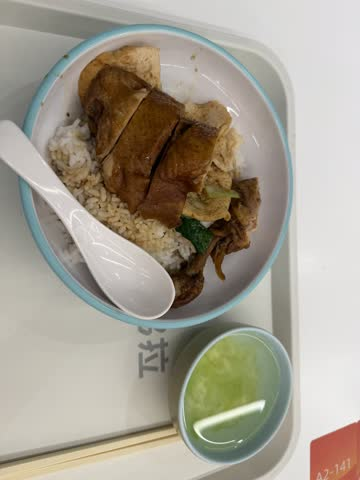

| | 热量 | 蛋白质 | 脂肪 | 碳水 |
|---|---:|---:|---:|---:|
| 熟米饭 约 230 g | 267 | 6 g | 1 g | 60 g |
| 去皮鸡腿 约 140 g | 252 | 36 g | 10 g | 0 |
| 豆皮 约 40 g | 80 | 8 g | 4 g | 3 g |
| 青菜 约 20 g | 6 | 1 g | 0 | 1 g |
| 蛋花汤 1 小碗 | 25 | 2 g | 1 g | 2 g |
| **合计** | **630** | **53 g** | **16 g** | **66 g** |

鸡腿按去皮的肉估算。米饭按碗里的量估算。

#### 晚加餐

| | 热量 | 蛋白质 | 脂肪 | 碳水 |
|---|---:|---:|---:|---:|
| 香蕉 1 根，约 120 g | 105 | 1 g | 0 | 27 g |
| 无糖可乐 1 罐 | 0 | 0 | 0 | 0 |
| **合计** | **105** | **1 g** | **0** | **27 g** |

**当天合计：1947 kcal，蛋白质 156 g，脂肪 55 g，碳水 198 g。**

### 体重

23:30，83.55 kg。

## 2026-10-16

### 饮食

#### 早饭

| | 热量 | 蛋白质 | 脂肪 | 碳水 |
|---|---:|---:|---:|---:|
| 高纤快熟燕麦片 100 ml，40 g | 165 | 4.9 g | 5.4 g | 21.9 g |
| 特仑苏低脂 250 ml | 118 | 9 g | 3 g | 13 g |
| 煎蛋 1 个 | 72 | 6 g | 5 g | 0 |
| 煎蛋的油 1 g | 9 | 0 | 1 g | 0 |
| 盐焗混合坚果 10 g | 64 | 1.7 g | 5.5 g | 2.0 g |
| 蓝莓 约 12 颗，约 20 g | 11 | 0 | 0 | 3 g |
| 黑咖啡 1 包，2 g | 7 | 0.4 g | 0 | 1.4 g |
| **合计** | **446** | **22.0 g** | **19.9 g** | **41.3 g** |

燕麦按《日常》的 40 g。奇亚籽、亚麻籽已经含在这 40 g 里。煎蛋的油按《日常》的 1 g。

#### 午饭

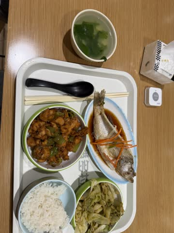

| | 热量 | 蛋白质 | 脂肪 | 碳水 |
|---|---:|---:|---:|---:|
| 熟米饭 约 180 g | 209 | 5 g | 1 g | 47 g |
| 青椒鸡丁 约 130 g | 310 | 34 g | 17 g | 4 g |
| 清蒸鱼 约 140 g | 150 | 26 g | 5 g | 0 |
| 卷心菜 约 160 g | 48 | 3 g | 1 g | 8 g |
| 青菜汤 1 碗 | 40 | 2 g | 1 g | 4 g |
| **合计** | **757** | **70 g** | **25 g** | **63 g** |

鸡丁按可吃的肉估算，炒菜的油算在这 130 g 里。鱼按可吃的肉估算，头骨不算。

#### 晚饭

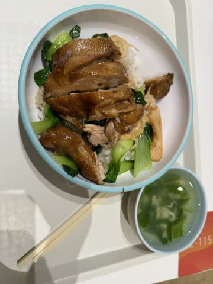

| | 热量 | 蛋白质 | 脂肪 | 碳水 |
|---|---:|---:|---:|---:|
| 熟米饭 约 180 g | 209 | 5 g | 1 g | 47 g |
| 去皮鸡腿 120 g | 216 | 31 g | 8 g | 0 |
| 豆皮 约 30 g | 60 | 6 g | 3 g | 2 g |
| 青菜 约 80 g | 24 | 2 g | 0 | 4 g |
| 青菜汤 1 小碗 | 30 | 2 g | 1 g | 3 g |
| **合计** | **539** | **46 g** | **13 g** | **56 g** |

鸡腿按 120 g 去皮的肉。米饭、豆皮、青菜按碗里的量估算。

**当天合计：1742 kcal，蛋白质 138 g，脂肪 58 g，碳水 160 g。**

### 体重

23:30，83.9 kg。

## 2026-10-17

### 饮食

#### 早饭

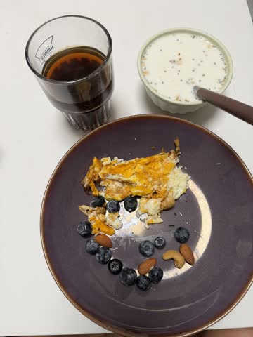

| | 热量 | 蛋白质 | 脂肪 | 碳水 |
|---|---:|---:|---:|---:|
| 高纤快熟燕麦片 100 ml，40 g | 165 | 4.9 g | 5.4 g | 21.9 g |
| 特仑苏低脂 250 ml | 118 | 9 g | 3 g | 13 g |
| 煎蛋 1 个 | 72 | 6 g | 5 g | 0 |
| 煎蛋的油 1 g | 9 | 0 | 1 g | 0 |
| 盐焗混合坚果 10 g | 64 | 1.7 g | 5.5 g | 2.0 g |
| 蓝莓 约 12 颗，约 20 g | 11 | 0 | 0 | 3 g |
| 黑咖啡 1 包，2 g | 7 | 0.4 g | 0 | 1.4 g |
| **合计** | **446** | **22.0 g** | **19.9 g** | **41.3 g** |

燕麦按《日常》的 40 g。奇亚籽、亚麻籽已经含在这 40 g 里。煎蛋的油按《日常》的 1 g。

#### 午饭

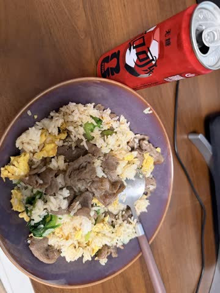

| | 热量 | 蛋白质 | 脂肪 | 碳水 |
|---|---:|---:|---:|---:|
| 生米 120 g | 415 | 8 g | 1 g | 94 g |
| 牛肉 240 g | 280 | 50 g | 10 g | 0 |
| 鸡蛋 1.5 个 | 108 | 9 g | 8 g | 0 |
| 油 约 3 g | 27 | 0 | 3 g | 0 |
| 青菜 约 30 g | 9 | 1 g | 0 | 2 g |
| 无糖可乐 1 罐 | 0 | 0 | 0 | 0 |
| **合计** | **839** | **68 g** | **22 g** | **96 g** |

米饭按生米 120 g 算，加水 132 ml 蒸的。牛肉按 240 g 瘦牛肉算。

#### 晚饭

| | 热量 | 蛋白质 | 脂肪 | 碳水 |
|---|---:|---:|---:|---:|
| 生米 100 g | 346 | 7 g | 1 g | 78 g |
| 牛肉 200 g | 233 | 42 g | 8 g | 0 |
| 鸡蛋 1 个 | 72 | 6 g | 5 g | 0 |
| 生菜 150 g | 23 | 2 g | 0 | 3 g |
| 油 约 3 g | 27 | 0 | 3 g | 0 |
| **合计** | **701** | **57 g** | **17 g** | **81 g** |

没拍照。米饭按生米 100 g 算，加水 110 ml 蒸的。牛肉按 200 g 瘦牛肉算，和午饭同一套数。

#### 晚加餐

| | 热量 | 蛋白质 | 脂肪 | 碳水 |
|---|---:|---:|---:|---:|
| 香蕉 1 根，130 g | 114 | 1 g | 0 | 29 g |
| **合计** | **114** | **1 g** | **0** | **29 g** |

**当天合计：2100 kcal，蛋白质 148 g，脂肪 59 g，碳水 247 g。**

### 训练

晚上低强度踢足球 2 小时。

### 体重

23:30，82.35 kg。

## 2026-10-18

### 饮食

#### 早饭

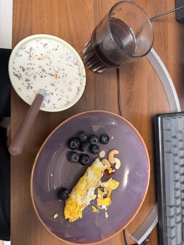

| | 热量 | 蛋白质 | 脂肪 | 碳水 |
|---|---:|---:|---:|---:|
| 高纤快熟燕麦片 100 ml，40 g | 165 | 4.9 g | 5.4 g | 21.9 g |
| 特仑苏低脂 250 ml | 118 | 9 g | 3 g | 13 g |
| 煎蛋 1 个 | 72 | 6 g | 5 g | 0 |
| 煎蛋的油 1 g | 9 | 0 | 1 g | 0 |
| 盐焗混合坚果 10 g | 64 | 1.7 g | 5.5 g | 2.0 g |
| 蓝莓 约 12 颗，约 20 g | 11 | 0 | 0 | 3 g |
| 黑咖啡 1 包，2 g | 7 | 0.4 g | 0 | 1.4 g |
| **合计** | **446** | **22.0 g** | **19.9 g** | **41.3 g** |

燕麦按《日常》的 40 g。奇亚籽、亚麻籽已经含在这 40 g 里。煎蛋的油按《日常》的 1 g。

#### 午饭

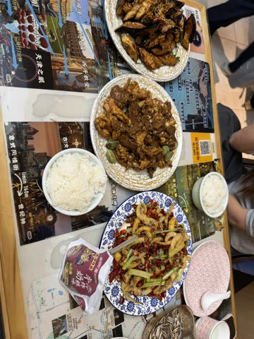
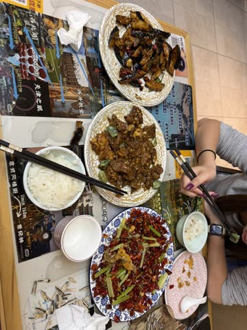

放纵餐，两个人吃。菜按你的一半。

| | 热量 | 蛋白质 | 脂肪 | 碳水 |
|---|---:|---:|---:|---:|
| 熟米饭 约 150 g | 174 | 4 g | 1 g | 39 g |
| 风味茄子 约 100 g | 150 | 1 g | 9 g | 16 g |
| 老爆三 约 70 g | 118 | 13 g | 6 g | 3 g |
| 干煸鱿鱼须 约 50 g | 70 | 9 g | 3 g | 2 g |
| 海河煎饼果子牛奶 125 ml | 80 | 3 g | 4 g | 8 g |
| **合计** | **592** | **30 g** | **23 g** | **68 g** |

三盘菜按吃前、吃后看两个人一共吃掉多少，再取一半。米饭只算左边那碗，吃掉大约 150 g 熟饭；右边小碗是另一位的。风味茄子按天津甜口，糖算在碳水里。老爆三是猪肝、猪腰、里脊。鱿鱼须只算能吃的，干辣椒不算。牛奶是那一袋 125 ml，按你喝了整袋。瓜子没算。

#### 晚饭

| | 热量 | 蛋白质 | 脂肪 | 碳水 |
|---|---:|---:|---:|---:|
| 双层芝士汉堡 2 个，去酱、芝士还在 | 836 | 54 g | 44 g | 56 g |
| 无糖可乐 2 杯 | 0 | 0 | 0 | 0 |
| **合计** | **836** | **54 g** | **44 g** | **56 g** |

没拍照。汉堡按麦当劳双层吉士汉堡的包装数，每个去掉番茄酱和芥末酱，两片芝士还在。一个大约 418 kcal，两个 836 kcal。

**当天合计：1874 kcal，蛋白质 106 g，脂肪 87 g，碳水 165 g。**

## 2026-10-19

### 饮食

#### 早饭

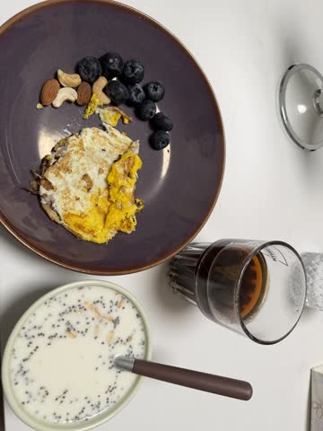

| | 热量 | 蛋白质 | 脂肪 | 碳水 |
|---|---:|---:|---:|---:|
| 高纤快熟燕麦片 100 ml，40 g | 165 | 4.9 g | 5.4 g | 21.9 g |
| 特仑苏低脂 250 ml | 118 | 9 g | 3 g | 13 g |
| 煎蛋 1 个 | 72 | 6 g | 5 g | 0 |
| 煎蛋的油 1 g | 9 | 0 | 1 g | 0 |
| 盐焗混合坚果 10 g | 64 | 1.7 g | 5.5 g | 2.0 g |
| 蓝莓 约 12 颗，约 20 g | 11 | 0 | 0 | 3 g |
| 黑咖啡 1 包，2 g | 7 | 0.4 g | 0 | 1.4 g |
| **合计** | **446** | **22.0 g** | **19.9 g** | **41.3 g** |

燕麦按《日常》的 40 g。奇亚籽、亚麻籽已经含在这 40 g 里。煎蛋的油按《日常》的 1 g。

#### 午饭

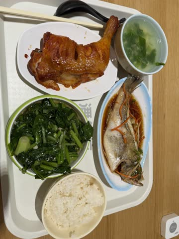

| | 热量 | 蛋白质 | 脂肪 | 碳水 |
|---|---:|---:|---:|---:|
| 熟米饭 约 180 g | 209 | 5 g | 1 g | 47 g |
| 去皮鸡腿 140 g | 252 | 36 g | 9 g | 0 |
| 清蒸鱼 约 140 g | 150 | 26 g | 5 g | 0 |
| 青菜 约 160 g | 48 | 4 g | 1 g | 8 g |
| 青菜汤 1 小碗 | 30 | 2 g | 1 g | 3 g |
| **合计** | **689** | **73 g** | **17 g** | **58 g** |

鸡腿按去皮，这只肉 140 g。鱼按可吃的肉估算，头骨不算。米饭、青菜按碗里的量估算。

#### 晚饭

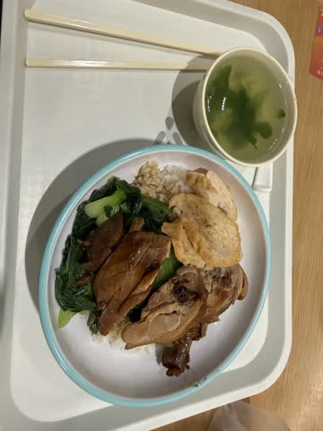

| | 热量 | 蛋白质 | 脂肪 | 碳水 |
|---|---:|---:|---:|---:|
| 熟米饭 约 150 g | 174 | 4 g | 1 g | 39 g |
| 去皮鸡肉 约 140 g | 252 | 36 g | 9 g | 0 |
| 青菜 约 100 g | 30 | 3 g | 0 | 5 g |
| 青菜汤 1 碗 | 40 | 2 g | 1 g | 4 g |
| **合计** | **496** | **45 g** | **11 g** | **48 g** |

鸡肉按《日常》去皮。深色的是鸡腿，右边浅色三片也按鸡肉算，肉一共约 140 g。米饭、青菜按盘里的量估算。

**当天合计：1631 kcal，蛋白质 140 g，脂肪 48 g，碳水 147 g。**

### 体重

23:30，83.05 kg。

## 2026-10-20

### 饮食

#### 早饭

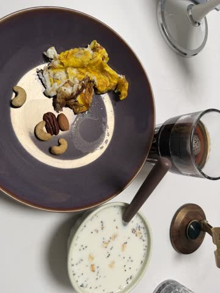

| | 热量 | 蛋白质 | 脂肪 | 碳水 |
|---|---:|---:|---:|---:|
| 高纤快熟燕麦片 100 ml，40 g | 165 | 4.9 g | 5.4 g | 21.9 g |
| 特仑苏低脂 250 ml | 118 | 9 g | 3 g | 13 g |
| 煎蛋 1 个 | 72 | 6 g | 5 g | 0 |
| 煎蛋的油 1 g | 9 | 0 | 1 g | 0 |
| 盐焗混合坚果 10 g | 64 | 1.7 g | 5.5 g | 2.0 g |
| 黑咖啡 1 包，2 g | 7 | 0.4 g | 0 | 1.4 g |
| **合计** | **435** | **22.0 g** | **19.9 g** | **38.3 g** |

燕麦按《日常》的 40 g。奇亚籽、亚麻籽已经含在这 40 g 里。煎蛋的油按《日常》的 1 g。这顿没有蓝莓。
